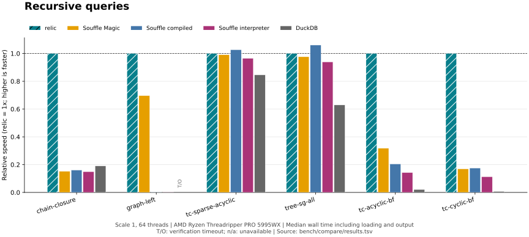
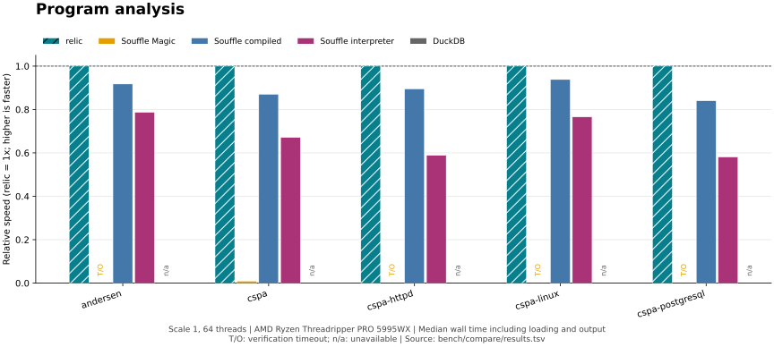

# relic

relic is an ultra-fast embeddable Datalog engine for dependency analysis, graph queries and reasoning over tables. Describe your data as facts and the relationships you want as rules: relic follows dependency chains, computes reachability and derives answers across any number of steps.

Run queries directly from your shell or embed the same engine in your C
application with `librelic`. No program compilation step, no server, and no
third-party runtime dependencies. Import CSV or TSV, explore interactively,
and send the answers back into your pipeline.

It's designed to be friendly enough for everyday work and fast enough to be a part of code analysis pipelines or binary analysis frameworks.

The [project website](https://stass.github.io/relic/) includes a quickstart,
language tutorial, C API overview and a
[browser playground](https://stass.github.io/relic/playground.html).
The optional [WebAssembly module](wasm/README.md) embeds the same engine in
browser and Node.js applications, with typed results and worker cancellation.

* **High performance.** In our
  [benchmark suite](#performance), relic beats leading Datalog engines on
  most workloads, often by a wide margin, including compiled Soufflé.
* **Query-aware execution.** Query-directed evaluation and indexed joins
  avoid unnecessary work; recursive evaluation reuses earlier results.
  Multi-core execution shares large rounds across available processors.
* **Fits into the tools you use.** A command-line tool for scripts, a REPL for exploration, and a C API for applications. Text, CSV, TSV and JSON output make results easy to consume.
* **Portable.** C11, BSD 2-Clause licensing, and no required
  third-party runtime libraries. Optional `libedit` adds REPL line editing.

## Find what a change affects

Which applications depend on a database, even through other services?
These two rules follow the entire dependency chain. Save this as `impact.dl`:

```prolog impact.dl
depends(web, api).
depends(api, database).
depends(worker, api).

affected(App, Changed) :- depends(App, Changed).
affected(App, Changed) :- depends(App, Middle), affected(Middle, Changed).
```

This query returns applications that depend directly or indirectly on the
database:

```sh
$ relic -s -q 'affected(App, database)?' impact.dl
api
web
worker
```

Lowercase identifiers such as `api` are symbols; uppercase identifiers such
as `App` are variables. `:-` means "if", and a query ends in `?`. `-s` sorts
the answers. The same rules handle longer dependency chains and cycles.

Use `relic -i impact.dl` for interactive queries, or include queries in the
program itself. [EXAMPLES.md](EXAMPLES.md) provides runnable examples of
negation, arithmetic, aggregates, table processing and the C API.

## Data files

Import data with `-I` and declare column types with `-T`. For example,
`edge.tsv` can hold these two tab-separated rows:

```text edge.tsv
a	b
b	c
```

Save the rules and query as `reach.dl`:

```prolog reach.dl
% What a can reach, over edges given as a table.
path(X, Y) :- edge(X, Y).
path(X, Z) :- edge(X, Y), path(Y, Z).
path(a, X)?
```

The file name `edge.tsv` supplies the predicate name and input format:

```sh
$ relic -T edge:symbol,symbol -I edge.tsv reach.dl
b
c
```

Programs contain facts, rules and queries; the command line chooses the
files. Loading someone else's program gives it no file access of its own;
bound its memory and tuples with `-l memory=` and `-l tuples=`.

`-F` chooses the answer format, and `-o` writes answers to a file. `-O`
exports a whole relation after the queries have run: `-O path.tsv` writes
a table for `-T` and `-I`, and `-O path.dl` writes typed Datalog facts that
another run can load:

```sh
$ relic -n -T edge:symbol,symbol -I edge.tsv -O path.dl reach.dl && relic -q 'path(a, X)?' path.dl
b
c
```

See the [table examples](EXAMPLES.md#data-in-importing-tables) and
[relic(1)](man/relic.1) for headers, column selection and explicit predicate
names.

## Use cases

* **Dependency analysis.** Follow package, build or service dependencies,
  detect cycles and compute the impact of a change. The
  [dependency planner](EXAMPLES.md#what-can-i-work-on-next) demonstrates
  scheduling with prerequisites.
* **Graph queries.** Compute network reachability, trace relationships and
  find paths. The [metro example](EXAMPLES.md#fewest-stops-on-the-metro)
  combines recursion and aggregation to find the fewest stops between stations.
* **Static analysis.** Express call-graph reachability or points-to analysis
  as rules over facts extracted from source code. The benchmark
  suite includes points-to inputs from Apache httpd, PostgreSQL and Linux.
* **Table processing.** Join CSV and TSV exports, group files by directory,
  or compute counts, sums and rankings. A
  [game leaderboard](EXAMPLES.md#data-in-importing-tables) demonstrates
  aggregation over imported tables.
* **Relationship modeling.** Derive indirect relationships from base facts.
  The [family tree](EXAMPLES.md#a-family-tree) covers ancestry, cousins,
  negation and descendant counts.

## How relic keeps queries fast

* **Recursive evaluation.** Semi-naive evaluation avoids repeating
  work from earlier rounds. Indexed joins and automatic join ordering keep
  lookups focused. Magic Sets specialize evaluation to a query's bindings,
  so a focused question can avoid computing an entire relation.
* **Multi-core execution.** `-j 0` uses the available processors, up to 256
  threads; `-j 16` requests sixteen. Large evaluation rounds share their
  work, while small rounds stay on one thread. Answers, their order and
  diagnostics stay the same at every thread count.
* **Inspect the work.** `-e` explains the query plan; `-X stats` reports
  the work the engine does, so you can understand how a query is evaluated.

## Install

With [Homebrew](https://brew.sh/) installed:

```sh
brew install stass/tap/relic
```

The [relic formula](https://github.com/stass/homebrew-tap/blob/master/Formula/relic.rb)
installs the command-line tool, library, header and manual pages.

From a release tarball, a C11 compiler, `make` and a POSIX shell are enough.
Installing into `/usr/local` usually needs root; choose another `--prefix` to
install as yourself:

```sh
./configure --prefix=/usr/local
make
make check
make install
```

This installs the `relic` tool and its manual page, the shared and static
`librelic`, the header `<relic.h>`, the `relic(3)` manual page and the
`librelic.pc` pkg-config file under the prefix. Out-of-tree builds are
supported and preferred:

```sh
mkdir build && cd build
../configure && make && make check
```

From a git checkout, generate the build system first. This needs autoconf
2.69, automake 1.13 and libtool 2.4.2 or newer, which are maintainer tools
only:

```sh
./autogen.sh
```

The configure options that matter most:

* `--prefix=DIR` chooses where to install; `DESTDIR` staging works as usual.
* `--with-libedit=auto|yes|no` controls line editing in the interactive
  mode. The default, `auto`, uses `libedit` if it is present. It is the
  only optional dependency.
* `--disable-threads` builds an engine that runs on the calling thread
  alone.
* `--disable-shared` or `--disable-static` installs only one kind of
  library.
* `--enable-thinlto` links with LLVM ThinLTO, as the benchmark builds do.

<details>
<summary>All build options</summary>

```text
--enable-debug          assertions, -O0 -g3                    (default: no)
--enable-werror         treat warnings as errors               (default: no)
--enable-thinlto        LLVM link-time optimization            (default: no)
--disable-threads       evaluate on the calling thread alone   (default: threads)
--enable-asan           AddressSanitizer                       (default: no)
--enable-ubsan          UndefinedBehaviorSanitizer             (default: no)
--enable-lsan           LeakSanitizer, where it stands alone   (default: no)
--enable-msan           MemorySanitizer, clang on Linux        (default: no)
--enable-tsan           ThreadSanitizer                        (default: no)
--enable-coverage       gcov or llvm-cov instrumentation       (default: no)
--enable-fuzzers        build tests/fuzz, clang only           (default: no)
--with-libedit=auto|yes|no
                        line editing and history in the REPL   (default: auto)
```

ThinLTO optimizes across source files at link time. Enable it with
`./configure --enable-thinlto`; use `CFLAGS='-O3 -g'` to select the
optimization level used by the benchmark builds. Configuration checks the
selected compiler, archiver, archive indexer, symbol reader and linker,
and fails if they cannot build ThinLTO. Clang with the native toolchains
on macOS and FreeBSD supports this option. Other installations may need
matching LLVM tools selected through `CC`, `AR`, `RANLIB` and `NM`, and an
LTO-capable linker selected through `LDFLAGS`.

Executables and shared libraries contain native code. The installed static
archive contains LLVM bitcode, so programs linking it need a compatible
compiler and linker. For a static-only installation, use
`pkg-config --static --libs librelic` to include its private dependencies.
ThinLTO adds no runtime dependency and does not change
the runtime worker count. It can increase executable size; function
alignment is a separate compiler setting.

LLVM bitcode also retains the compiler's source filename, which
`-ffile-prefix-map` does not rewrite. For distributable static archives,
build in the source tree or invoke `configure` through a relative source
path so that this filename does not contain an absolute build-machine path.

</details>

<details>
<summary>Sanitizer suites and strict checks</summary>

```sh
make check          the unit and language suites
make check-asan     reconfigure with AddressSanitizer, rebuild, run the suite
make check-lsan     the same under LeakSanitizer, where it stands alone
make check-msan     the same under MemorySanitizer, where it is supported
make check-ubsan    the same under UndefinedBehaviorSanitizer
make check-tsan     the same under ThreadSanitizer, with threads enabled
```

Each sanitizer suite configures a disposable build tree under `disposable/`
in the current build directory, from a copy of the distributed sources, so it
never leaves instrumented objects in the tree you work in and works whether
that tree was configured in place or not. A sanitizer the platform does not
support reports that and succeeds rather than failing the build.

A few tests need a tool the build does not, such as `mandoc`, `nm` or
`pkg-config`, and are skipped without it. On a machine set up to run every
check, set `RELIC_STRICT_CHECK=yes` in the environment: a skipped test then
fails, and so do a sanitizer suite the compiler cannot build and an
`installcheck` without `pkg-config`. A skip that is expected there is named
in `RELIC_ALLOWED_SKIPS`, a space-separated list of test file names and
targets:

```sh
RELIC_STRICT_CHECK=yes RELIC_ALLOWED_SKIPS=symbols.sh make distcheck
```

</details>

## Supported platforms

relic supports macOS, Linux with glibc or musl, and FreeBSD. OpenBSD and
NetBSD are portability targets without release validation. Continuous
integration builds and tests a release tarball on Linux with glibc and musl
and on FreeBSD for every change.

## Use from C

`librelic` installs one header, `<relic.h>`, and a pkg-config module named
`librelic`. Compile and link a program against it with:

```sh
cc -o sample sample.c $(pkg-config --cflags --libs librelic)
```

If the library was installed under a prefix that pkg-config does not search,
such as `--prefix=$HOME/.local`, name its directory first:
`PKG_CONFIG_PATH=$HOME/.local/lib/pkgconfig`. For a static-only
installation, add `--static` to the `pkg-config` command. A program linked
against the shared library also has to find it when it runs: install into a
directory the system searches (on Linux, run `ldconfig` after installing),
set `LD_LIBRARY_PATH` to the library directory, or link with
`-Wl,-rpath,DIR`.

This `sample.c` loads the program of the example above, answers the query
and prints each application it finds:

```c
#include <stdio.h>
#include <stdlib.h>

#include <relic.h>

/* Called once per answer row; a nonzero return stops the query. */
static int
print_row(void *arg, const relic_value_t *values, size_t count)
{
	relic_t *ctx = arg;

	/* A symbol is safe to print as it is; escape a string before it
	 * reaches a terminal. */
	if (count > 0 && values[0].type == RELIC_SYMBOL)
		puts(relic_string(ctx, values[0].v.id, NULL));
	return (0);
}

int
main(void)
{
	static char name[] = "sample";
	relic_config_t cfg = { 0 };
	relic_query_t *query = NULL;
	relic_t *ctx;
	int status;

	/* A zeroed configuration asks for every default. */
	cfg.max_memory = (size_t)256 << 20;
	cfg.threads = 4;
	ctx = relic_create_config(&cfg, sizeof cfg);
	if (ctx == NULL)
		return (EXIT_FAILURE);
	relic_diag_set(ctx, relic_diag_stderr, name);

	status = relic_load_string(ctx, "impact",
	    "depends(web, api). depends(api, database).\n"
	    "depends(worker, api).\n"
	    "affected(A, C) :- depends(A, C).\n"
	    "affected(A, C) :- depends(A, M), affected(M, C).\n");
	if (status == 0)
		query = relic_query_prepare(ctx, NULL, "affected(App, database)?");
	if (query == NULL || relic_query_run(ctx, query, print_row, ctx) != 0)
		status = -1;

	relic_query_destroy(query);
	relic_destroy(ctx);

	if (fflush(stdout) == EOF || ferror(stdout))
		status = -1;
	return (status == 0 ? EXIT_SUCCESS : EXIT_FAILURE);
}
```

It prints `api`, `web` and `worker`. The order of the rows is unspecified,
though the same on every run; `relic_value_compare()` orders them when you
need a particular order. A few conventions apply to the whole API:

* Every failure is reported by the return value: `-1` from a function that
  returns `int`, `NULL` from one that returns a pointer. For a call on a
  context, the diagnostic callback receives the explanation, and
  `relic_error()` and `relic_error_class()` describe the most recent
  failure; `relic_create()` reports through `errno`. Nothing exits the
  process.
* A structure the library reads or fills, a `relic_config_t` for example,
  is passed with its size, as in `relic_create_config(&cfg, sizeof cfg)`.
  This lets a later release add fields without breaking a program built
  against this one. Zero the structure before setting its fields.
* Contexts share nothing, so each thread may use its own. One context is
  used by one thread at a time; `relic_interrupt()` is the one call another
  thread, or a signal handler, may make on it.
* A query's rows go to a callback as they are derived, or are collected
  into a result that outlives the context.
* Only symbols that begin with `relic_` are exported. The
  `RELIC_UNSTABLE_*` configuration switches exist for testing and are not
  part of the interface.

[relic(3)](man/relic.3) describes every function.
[examples/query.c](examples/query.c) and [examples/embed.c](examples/embed.c)
are complete programs that use only the public API; `make installcheck`
builds `embed.c` against the installed library.

## Performance

relic records the **lowest median wall time on 26 of 31 workloads with
16 threads**, and **22 of 31 with one thread**, against completed rival runs.
At the largest tested scale, it leads on **19 of 28 workloads with 16 threads**.
The suite compares compiled Soufflé (with and without Magic Sets), Nemo,
SWI-Prolog, clingo, DuckDB and SQLite.

Selected workloads show recursive queries, points-to analyses and table
processing. Taller bars mean faster execution, with relic fixed at 1×;
missing results are labeled rather than plotted as zero.





Charts are generated from the recorded timings with
[plot-performance.py](bench/compare/tools/plot-performance.py).

All 31 workloads below show relic, compiled Soufflé with Magic Sets,
and standard compiled Soufflé. The fastest rival column names the fastest
completed rival at this scale and thread count. Speedup compares relic with
that rival. relic runs Datalog directly, without a program compilation step.

| Workload | relic | Soufflé Magic | Soufflé compiled | Fastest rival | relic speedup |
| --- | ---: | ---: | ---: | --- | ---: |
| `chain-left` | **2.51 ms** | 200 ms | 791 ms | Soufflé Magic: 200 ms | 79.7× 🟢 |
| `grid-reach` | **15.7 ms** | 53.2 ms | 52.1 ms | Soufflé compiled: 52.1 ms | 3.3× 🟢 |
| `dist-bounded` | **96.5 ms** | 374 ms | 290 ms | Soufflé compiled: 290 ms | 3.0× 🟢 |
| `cspa` | **32.8 ms** | 21.5 s | 93.7 ms | Soufflé compiled: 93.7 ms | 2.9× 🟢 |
| `chain-closure` | **245 ms** | 1.01 s | 898 ms | DuckDB: 690 ms | 2.8× 🟢 |
| `tc-sparse-acyclic` | **13.3 ms** | 36.2 ms | 32.2 ms | Soufflé compiled: 32.2 ms | 2.4× 🟢 |
| `tc-sparse-cyclic` | **64.3 ms** | 195 ms | 150 ms | Soufflé compiled: 150 ms | 2.3× 🟢 |
| `sg-acyclic` | **50.7 ms** | 151 ms | 117 ms | Soufflé compiled: 117 ms | 2.3× 🟢 |
| `tc-acyclic-fb` | **9.41 ms** | 20.5 ms | 137 ms | Soufflé Magic: 20.5 ms | 2.2× 🟢 |
| `sg-acyclic-bf` | **2.64 ms** | 5.75 ms | 73.2 ms | Soufflé Magic: 5.75 ms | 2.2× 🟢 |
| `startup` | **1.32 ms** | 2.83 ms | 2.87 ms | Soufflé Magic: 2.83 ms | 2.1× 🟢 |
| `tree-sg-all` | **13.9 ms** | 30.5 ms | 29.2 ms | Soufflé compiled: 29.2 ms | 2.1× 🟢 |
| `tc-cyclic-fb` | **10.5 ms** | 21.3 ms | 352 ms | Soufflé Magic: 21.3 ms | 2.0× 🟢 |
| `andersen` | **33 ms** | timeout | 61.5 ms | Soufflé compiled: 61.5 ms | 1.9× 🟢 |
| `sg-cyclic` | **151 ms** | 406 ms | 272 ms | Soufflé compiled: 272 ms | 1.8× 🟢 |
| `cspa-postgresql` | **12.5 s** | timeout | 22.3 s | Soufflé compiled: 22.3 s | 1.8× 🟢 |
| `tc-nonlinear` | **22.1 ms** | 59.9 ms | 39.2 ms | Soufflé compiled: 39.2 ms | 1.8× 🟢 |
| `chain-right` | **249 ms** | 989 ms | 773 ms | DuckDB: 427 ms | 1.7× 🟢 |
| `cspa-httpd` | **11.3 s** | timeout | 18.6 s | Soufflé compiled: 18.6 s | 1.6× 🟢 |
| `tree-sg-bound` | **4.54 ms** | 7.46 ms | 353 ms | Soufflé Magic: 7.46 ms | 1.6× 🟢 |
| `degree-count` | **30.9 ms** | 49.9 ms | 50 ms | Soufflé Magic: 49.9 ms | 1.6× 🟢 |
| `tc-acyclic` | **72.5 ms** | 156 ms | 101 ms | Soufflé compiled: 101 ms | 1.4× 🟢 |
| `graph-left` | **31.6 ms** | 42.6 ms | 34.4 s | Soufflé Magic: 42.6 ms | 1.3× 🟢 |
| `graph-reach` | **26.7 ms** | 35 ms | 34.7 ms | Soufflé compiled: 34.7 ms | 1.3× 🟢 |
| `tasks-ready` | **34.6 ms** | 46.3 ms | 43.4 ms | Soufflé compiled: 43.4 ms | 1.3× 🟢 |
| `tc-cyclic` | **190 ms** | 366 ms | 205 ms | Soufflé compiled: 205 ms | 1.1× 🟢 |
| `cspa-linux` | 6.91 s | timeout | 6.35 s | Soufflé compiled: **6.35 s** | 0.9× 🔴 |
| `tc-acyclic-bf` | 25.4 ms | 22.7 ms | 61.3 ms | Soufflé Magic: **22.7 ms** | 0.9× 🔴 |
| `facts-join` | 91.2 ms | 124 ms | 126 ms | DuckDB: **72.4 ms** | 0.8× 🔴 |
| `files-grouped` | 94.4 ms | 338 ms | 254 ms | DuckDB: **52.6 ms** | 0.6× 🔴 |
| `tc-cyclic-bf` | 255 ms | 121 ms | 124 ms | Soufflé Magic: **121 ms** | 0.5× 🔴 |

These are scale-1 medians with 16 threads on an Apple M3 Max with 128 GiB RAM.
Times include startup, loading, evaluation and output; compilation is excluded.
Soufflé and Nemo export files; other engines write to discarded stdout.

See the [full results](BENCHMARKS.md) for all workloads, timing spread and
memory use, and [methodology](specs/design-bench.md) to reproduce the comparison.

## Reliability and testing

relic checks its optimizations against a simple reference evaluator,
compares serial and parallel execution, and tests failure paths as well
as successful queries.

* **Differential fuzzing.** Four libFuzzer targets exercise program loading,
  evaluation, table import and regular expressions. The evaluation target
  compares optimized answers against naive evaluation of the whole program,
  catching wrong results as well as crashes.
* **Randomized testing.** The randomized suite compares evaluation
  strategies with indexing, join reordering,
  Magic Sets and parallel execution enabled or disabled. Weekly CI is
  configured for 10,000 program seeds and fifteen minutes per fuzz target
  under AddressSanitizer and UndefinedBehaviorSanitizer.
* **Regression and sanitizer suites.** The fuzz corpora are replayed by
  `make check`. Dedicated suites run under address, undefined-behavior,
  thread, memory and leak sanitizers where supported.
* **Resource limits and file access.** Tuple and evaluation-memory limits stop runaway derivations with diagnostics, and an input limit bounds the size of one program file or one field of an imported table. Programs express computation; the runner chooses which data files they can read and write. The memory limit covers evaluation storage, not total process memory.

The [testing design](specs/design-testing.md) explains the reference
checks, randomized testing and fuzzing. Run them locally with:

```sh
make check
make check-random RELIC_SEEDS=10000

# In a separate build configured with clang and
# --enable-fuzzers --enable-asan --enable-ubsan:
make fuzz FUZZ_SECONDS=900
```

## Limitations

A query that binds an argument is answered through a Magic Sets rewrite,
which derives only what the query can reach. A recursive rule that calls
its own predicate twice, with the bound argument passed to the first call,
costs that rewrite a second relation as large as the closure it derives. Of
these two definitions of a path, called as `path(a, X)?`:

```prolog
path(X, Z) :- path(X, Y), path(Y, Z).
path(X, Z) :- path(X, Y), edge(Y, Z).
```

the first keeps a second relation holding a copy of every path the rewrite
derives, and the second does not. Both give the same answers, and the copy
counts against the memory limit like any other relation. `relic -e` shows
the copy as a predicate named `sup$...`. Where memory matters, prefer the
linear form.

## Documentation

| File | Contents |
| --- | --- |
| [EXAMPLES.md](EXAMPLES.md) | a tour of relic through programs you can run |
| [man/relic.1](man/relic.1) | the tool and the language |
| [man/relic.3](man/relic.3) | the library |
| [specs/README.md](specs/README.md) | the design documents, where to start reading |
| [specs/architecture.md](specs/architecture.md) | the target design of the system |
| [specs/language.md](specs/language.md) | the specification of the language |
| [specs/style.md](specs/style.md) | code style, binding on all relic-owned code |
| [docs/research.md](docs/research.md) | papers, reference implementations and local methods behind the design |
| [NEWS](NEWS) | what changed in each release |
| [TODO.md](TODO.md) | open work, by severity |

## License

BSD 2-Clause. See [LICENSE](LICENSE).
